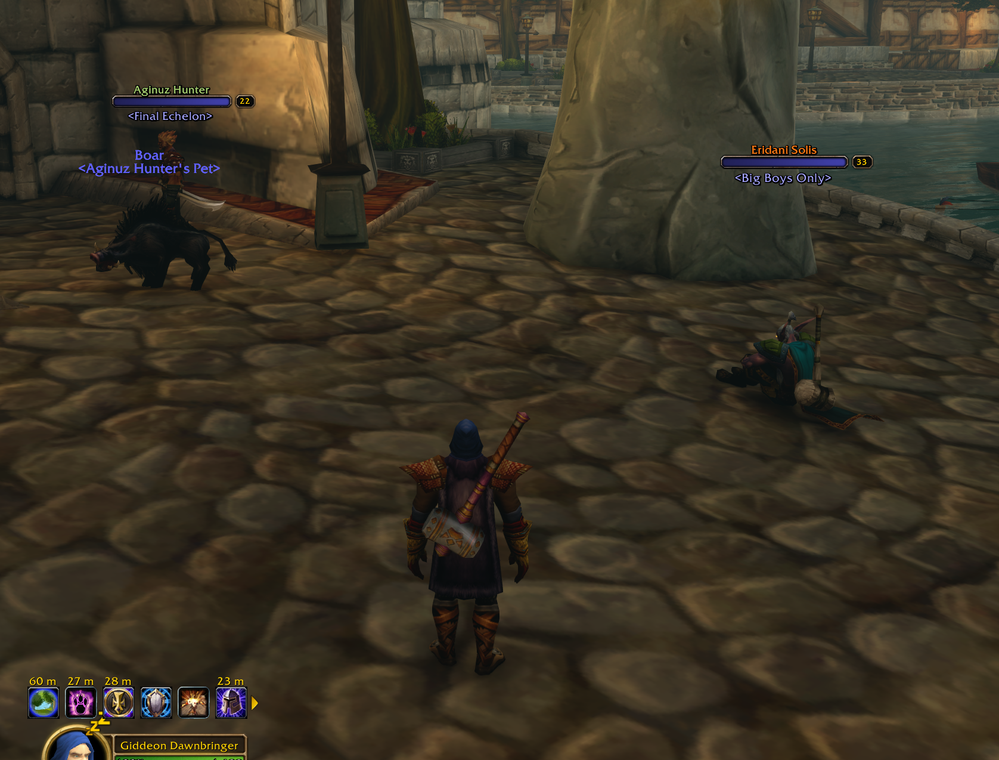
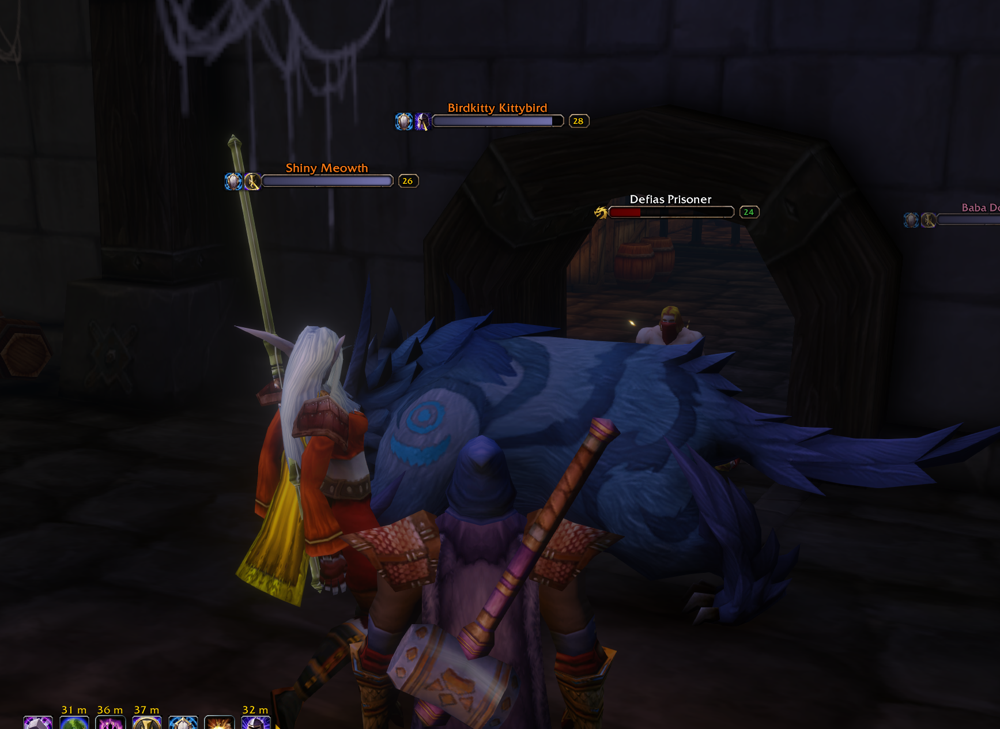

# NamePlateGuildNames

Show player guild names while keeping nameplates enabled in **WoW Forever**.

**[Download latest version](https://github.com/giddeondb/NamePlateGuildNames/releases/latest/download/NamePlateGuildNames.zip)** · [Release notes](https://github.com/giddeondb/NamePlateGuildNames/releases/latest) · [Report an issue](https://github.com/giddeondb/NamePlateGuildNames/issues)

Guild names appear beneath Blizzard's player nameplates without targeting or hovering over each player. Friendly guilds are lavender; non-friendly guilds are muted red. When a cast bar appears, the guild label moves below the cast bar and spell text, then returns when the bar hides.

NPCs, pets, and players without available guild information receive no label. No libraries or other addons are required.

## Screenshots

### Guild names with friendly nameplates enabled



The addon adds a guild line while keeping the existing health bars, player names, and level indicators.

### Default nameplates without the addon



This earlier screenshot shows the missing guild labels that prompted the addon. The screenshots show different players and locations; they are not a matched before-and-after pair.

## Installation

1. Download **NamePlateGuildNames.zip** above and quit WoW.
2. Extract it into `World of Warcraft/_forever_/Interface/AddOns/`.
   The resulting path should be `AddOns/NamePlateGuildNames/NamePlateGuildNames.toc`.
3. Start WoW and enable **NamePlateGuildNames** in the AddOns list.
4. Enable friendly and/or enemy nameplates in the game's settings.

For updates, replace the existing addon folder. Keep your `WTF` folder to preserve settings. GitHub's automatic source-code archives are for development; use the attached addon ZIP for installation.

## Commands

| Command | Action |
| --- | --- |
| `/ngn` | Show available commands |
| `/ngn on` / `/ngn off` | Show or hide guild labels |
| `/ngn size 12` | Set font size, from 8 to 24 |
| `/ngn offset -4` | Set vertical offset, from -60 to 60; negative moves down |
| `/ngn refresh` | Retry visible plates and print status |
| `/ngn status` | Show client version, tracked plates, labels, and any API errors |

Settings are stored in `NamePlateGuildNamesDB`. The addon does not change nameplate CVars or other addons. A positive offset can move text into the bars; the default is `-4`.

## Compatibility and limitations

Targets **WoW Forever interface 16001**, developed with client **1.60.1, build 70938**. Friendly guild labels have been confirmed in game. Enemy labels and behavior across all PvP, dungeon, and raid contexts have not been fully verified.

Blizzard can restrict access to nameplates or unit information. The addon skips inaccessible plates and restricted values. A missing guild value can mean either no guild or information the client has not supplied. It retries for about 3.5 seconds; `/ngn refresh` can retry later. Fully inaccessible plates may not appear in the status count.

Designed for Blizzard's default nameplates. Compatibility with nameplate replacement addons is not guaranteed. If you encounter a problem, include your client build, `/ngn status` output, whether you were in combat or an instance, and a screenshot in a GitHub issue.

## Development

The addon consists of one Lua file and its TOC. You can clone this repository into `Interface/AddOns/NamePlateGuildNames`, or symlink it there. After initial discovery by the client, use `/reload` to pick up Lua edits.

Run the local checks with Lua 5.1:

```sh
lua5.1 tests/lifecycle.lua NamePlateGuildNames.lua
luac5.1 -p NamePlateGuildNames.lua
```

The mocked tests cover guild data retries, player filtering, colors, recycled plates, restricted data, cast-bar transitions, and stale callbacks. They do not verify live rendering. In-game checks should include fishing, interrupted casts, untargeted players, combat, range changes, and dungeon transitions.

Build an installable ZIP with `python3 tools/package.py`. It writes `dist/NamePlateGuildNames.zip` and a versioned copy. Only addon files, README, changelog, and license are packaged; screenshots and tests remain in the repository. Releases are published on GitHub. CurseForge publishing is not configured.

## Author and license

By GiddeonDB. Code is licensed under the [BSD 3-Clause License](LICENSE). Screenshots depict World of Warcraft; game artwork belongs to its respective owners.
