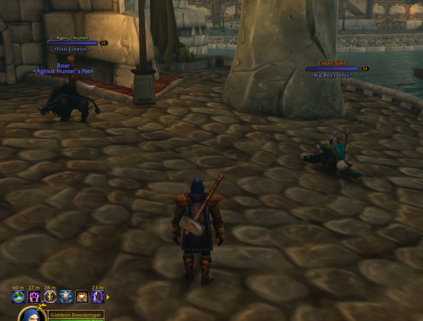
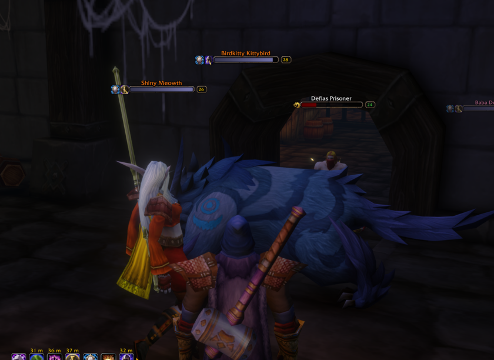

# NamePlateGuildNames

Show player guild names while keeping nameplates enabled in **WoW Forever**.

Guild names appear beneath Blizzard's player nameplates without targeting or hovering over each player. Friendly guilds are lavender; non-friendly guilds are muted red. While a cast bar is visible, the guild label moves below the cast bar and spell text, then returns when the bar hides.

NPCs, pets, and players without available guild information receive no label. No libraries or other addons are required.

## Guild names with friendly nameplates enabled

The addon adds a guild line while keeping the existing health bars, player names, and level indicators.

## Default nameplates without the addon

These screenshots show different players and locations. The earlier default-nameplate screenshot illustrates the missing guild labels that prompted the addon.

## Getting started

Install NamePlateGuildNames, enable it in the AddOns list, and enable friendly and/or enemy nameplates in the game's settings.

For manual installation, extract the addon into `World of Warcraft/_forever_/Interface/AddOns/`. The resulting path should be `AddOns/NamePlateGuildNames/NamePlateGuildNames.toc`.

## Commands

- `/ngn` shows available commands.
- `/ngn on` or `/ngn off` shows or hides guild labels.
- `/ngn size 12` sets font size, from 8 to 24.
- `/ngn offset -4` sets vertical offset, from -60 to 60. Negative values move text down.
- `/ngn status` shows a short diagnostic summary. `/ngn refresh` retries visible plates.

Settings persist between sessions. The addon does not change your nameplate settings or other addons.

## Compatibility

Designed for Blizzard's default nameplates in WoW Forever, interface 16001. Friendly guild labels have been confirmed in game. Enemy labels and all PvP, dungeon, and raid contexts have not been fully verified. Restricted nameplates and unavailable guild information are skipped. Nameplate replacement addons are not guaranteed to work with it.

[Source and README](https://github.com/giddeondb/NamePlateGuildNames) · [Report an issue](https://github.com/giddeondb/NamePlateGuildNames/issues)

By GiddeonDB. Code is licensed under BSD 3-Clause.
